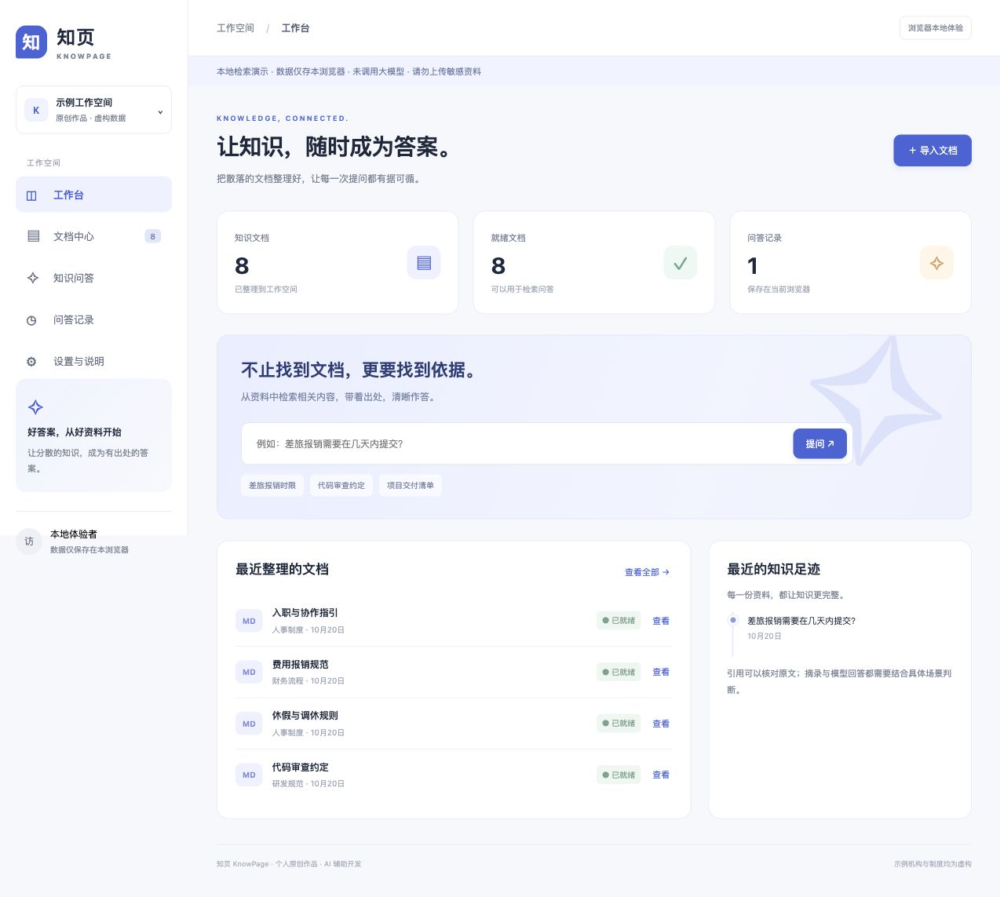
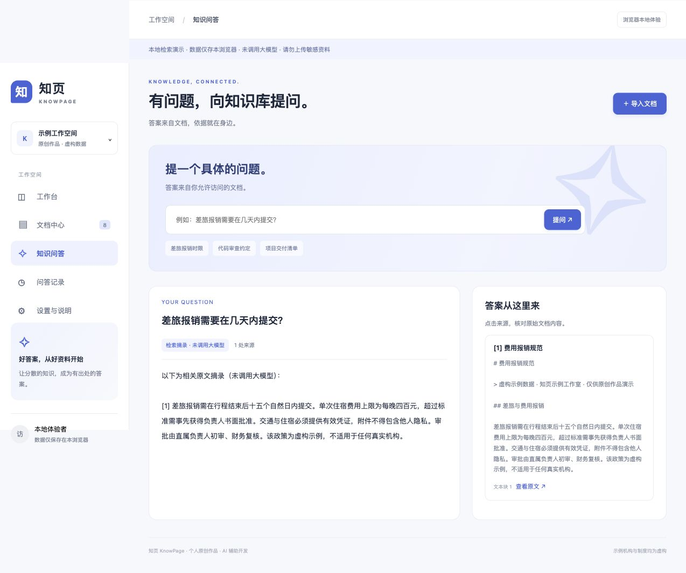

# 知页 KnowPage

个人原创知识库作品，使用虚构机构制度文档展示文档管理、可核查检索引用、问答历史，以及完整服务的登录和角色权限。AI 辅助开发，无真实客户、合同或商业上线经历。

> 公开体验是浏览器本地检索演示，**未调用大模型**。完整后端可本地运行；真实模型需要服务端配置，目前没有 live 调用验证。

## 在线与截图

源码：[GitHub 仓库](https://github.com/yang1256149685/knowpage-ai) · 在线体验：[打开演示](https://yang1256149685.github.io/knowpage-ai/)（公开静态版）。所有预置制度均为原创虚构数据；请勿上传真实企业资料。




## 已实现

- 原创文档、分类筛选、TXT/MD 导入；完整服务额外支持文本 PDF。
- 中文双字词/英文词分块检索，真实原文引用，无命中明确提示。
- 浏览器持久化与服务端 SQLite，分别保存文档及历史。
- 完整服务真实会话、管理员/阅读者权限、用户历史隔离。
- 文件限制、解析进程超时、来源删除时清除历史正文引用。
- 可配置服务端模型适配器；调用失败不会伪造答案。

## 立即运行静态体验

需要 Python 3（仅用于本地 HTTP 静态服务），无需安装前端依赖：

```bash
python3 -m http.server 8001 --bind 127.0.0.1 --directory web
```

打开 http://127.0.0.1:8001/ 。首次载入 8 份原创示例。浏览器刷新后数据仍在；设置可导出 JSON、清空或恢复示例。本模式不提供服务端账号、PDF 或真实模型调用。

## 运行完整服务

需要 Python 3.12。以下从本仓库根目录执行：

```bash
python3 -m venv .venv
source .venv/bin/activate
python -m pip install -r server/requirements.lock.txt
cp .env.example .env
```

将 `.env` 中 ADMIN_PASSWORD 和 READER_PASSWORD 填为各自至少 12 字符的本机密码；生产管理员至少 16 字符。不要把密码提交到 GitHub。然后将这些值注入进程环境，或在本地 shell 中安全输入：

```bash
read -r -s -p 'Admin password: ' ADMIN_PASSWORD; echo
read -r -s -p 'Reader password: ' READER_PASSWORD; echo
export ADMIN_PASSWORD READER_PASSWORD
python -m uvicorn server.app:app --host 127.0.0.1 --port 8765
```

上述隐藏输入示例使用 Bash；Zsh 可用 `read -s 'ADMIN_PASSWORD?Admin password: '`。本机直接启动不会自动读取 `.env`；Docker Compose 会读取它。所有可配置字段见 `.env.example`。

打开 http://127.0.0.1:8765/ ，使用 `admin` 或 `reader` 与刚设置的密码登录。默认 SQLite 位于 `data/knowpage.db`，首次启动导入公开样例；清空后不会自动恢复。已有用户密码不会因重新设置环境变量自动更改；首次引导只创建不存在的账号。改密码需另行实现受控管理流程，不要误以为重启就会轮换。

管理员能导入/删除，阅读者只能查看和提问。API 只允许同源会话；接口见 http://127.0.0.1:8765/docs 。仅在本机开发公开此 API 文档；上线可按需关闭。

## 模型模式

默认 `AI_MODE=retrieval` 为真实原文摘录。live 需要 `AI_MODE=live`、`AI_BASE_URL`（兼容服务的版本化基础地址）、`AI_API_KEY`、`AI_MODEL`；只能在服务端设置。适配器调用基础地址下的 `/chat/completions`，不保证所有厂商兼容。

模型会收到问题和命中文本，不能输入私有企业数据。引用 ID 校验无法保证回答正确。当前无真实模型验证，公开部署保持 retrieval；不要在缺少预算限额、用量审计与授权时开放带付费模型的公网服务。

## 测试

```bash
python -m unittest discover -s tests -v
node tests/retrieval.test.mjs
```

后端测试使用临时数据库和测试密码，覆盖上传、真实样例 PDF、权限、用户隔离、删除引用和模型未配置。Node 18+ 可运行前端检索断言。实际结果见 [测试记录](docs/testing.md)，截图来源见 [证据索引](docs/evidence.json)。

## 目录与部署

`web/` 前端；`server/` API/鉴权/数据库/检索；`samples/` 原创语料；`tests/` 自动测试；`deploy/` 容器与代理配置。参见 [架构](docs/architecture.md)、[部署与备份](docs/deployment.md)、[案例资料](docs/case-study.md)。

单机演示架构，不含企业 SSO、跨组织多租户、OCR、分布式队列、高可用或生产 SLA。静态托管不能运行 Python API。没有服务器时只能提供静态体验公网链接和完整服务部署材料。

## 许可与来源

业务代码及原创样例采用 MIT，见 LICENSE。依赖按各自许可证使用；主要依赖 FastAPI、Uvicorn、pypdf、python-multipart、httpx。图形标识由本项目文本/CSS 编写，无购买或抓取素材。页面及样例由 AI 辅助创建，并经运行与测试验证；不冒充真实商业案例。
